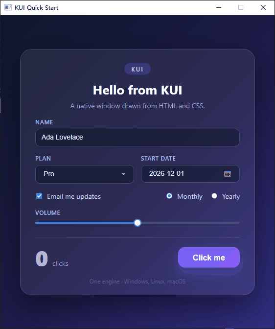

# 用 C 接入 KUI：快速上手

[English](QUICKSTART.md) · **简体中文**

[English](QUICKSTART.md)

用纯 C 把一个 HTML 页面做成原生窗口：一张带小表单和计数器的卡片，每点一次按钮，计数加一。

<p align="center"></p>
<p align="center"><sub>真实窗口的录屏：改表单，再点三次按钮。</sub></p>

页面就是普通的 HTML 和 CSS。除了计数器，还有一小块表单（文本框、下拉选择、日期选择、复选框、单选和滑块）。这些控件由 KUI 自己绘制和处理，不需要写代码：上面的录屏里依次输入了姓名、选了套餐和日期、切换了选项、拖了滑块，又点了按钮。

程序用的是 `kui_c.h` 和本仓库 `cmake/` 里的 `find_package(KuiC)` 配置。完整 API 见 `c/include/kui_c.h`，
调用约定见 `c/README.md`。

## 1. 要什么

- Visual Studio 2022（装上 C/C++ 工作负载，即 MSVC）、CMake 3.20 或更新、Git。
- 在这些版本上验证过：Windows 10 x64，MSVC 19.43（Visual Studio 2022 17.13），CMake 3.31.6，Git 2.45。

> 用普通的 PowerShell 就行，CMake 会自己找到 Visual Studio。

## 2. 拿到 SDK

```powershell
git clone --depth 1 https://github.com/kui-engine/kui.git
$KUI = "$PWD\kui"
```

要固定版本时写成 `git clone --depth 1 --branch v3.61.8 https://github.com/kui-engine/kui.git`。

> 请保留 `--depth 1`：每个版本都把运行库提交进历史，完整历史很大。

## 3. 建一个空项目

在克隆目录旁边新建文件夹 `hello-kui`，放三个文件：`CMakeLists.txt`、`main.c`、`app.html`。

```cmake
cmake_minimum_required(VERSION 3.20)
project(hello_kui LANGUAGES C)

find_package(KuiC 3 CONFIG REQUIRED)

add_executable(hello_kui main.c)
target_link_libraries(hello_kui PRIVATE KuiC::C)
kui_c_copy_runtime_dlls(hello_kui)

# Put the page next to the program after every build.
add_custom_command(TARGET hello_kui POST_BUILD
    COMMAND "${CMAKE_COMMAND}" -E copy_if_different
            "${CMAKE_CURRENT_SOURCE_DIR}/app.html" "$<TARGET_FILE_DIR:hello_kui>"
    VERBATIM)
```

```c
#include <kui_c.h>

#include <stdio.h>
#include <string.h>

typedef struct App {
    KuiElement* count; /* #count, looked up once */
    int clicks;
} App;

/* evt is borrowed: valid only during this call, never store or release it. */
static void on_click(KuiEvent* evt, void* user_data) {
    App* app = (App*)user_data;
    char text[16];
    (void)evt;
    snprintf(text, sizeof text, "%d", ++app->clicks);
    kui_element_set_text_content(app->count, text, 0); /* the DOM update */
}

int main(void) {
    KuiWindowProps props;
    KuiWindow* win = NULL;
    KuiDocument* doc = NULL;
    KuiElement* button = NULL;
    App app = {NULL, 0};
    int exit_code = 0;

    if (kui_platform_init() != KUI_OK) return 1;

    memset(&props, 0, sizeof props); /* 0 = library default for every field */
    props.title = "KUI Quick Start";
    props.width = 560; /* client area */
    props.height = 640;
    props.no_resize = 1;
    props.centered = 1;
    if (kui_window_create(&props, &win) != KUI_OK) return 1;

    /* The window owns its document; this hands back a counted reference. */
    kui_window_get_document(win, &doc);
    /* A relative path is resolved against the current directory. */
    kui_document_load_html_file(doc, "app.html", 0);
    if (kui_document_get_element_by_id(doc, "count", 0, &app.count) != KUI_OK) {
        fprintf(stderr, "app.html not found in the current directory\n");
        exit_code = 1;
    } else {
        kui_document_get_element_by_id(doc, "inc", 0, &button);
        kui_element_add_event_listener(button, "click", 0, on_click, &app, NULL);
        kui_platform_run(&exit_code); /* blocks until the window is closed */
        kui_element_release(button);
        kui_element_release(app.count);
    }

    kui_document_release(doc);
    kui_window_release(win); /* destroys the window */
    kui_platform_shutdown();
    return exit_code;
}
```

<details><summary>app.html（界面，复制即可）</summary>

```html
<!doctype html>
<html>
<head>
<meta charset="utf-8">
<title>KUI Quick Start</title>
<style>
  * { box-sizing: border-box; margin: 0; padding: 0; }
  html, body { height: 100%; }
  body {
    display: flex; align-items: center; justify-content: center;
    font-family: "Segoe UI", system-ui, -apple-system, "Helvetica Neue", Arial, sans-serif;
    font-size: 14px; color: #e2e8f0;
    background: linear-gradient(135deg, #0f172a 0%, #1e1b4b 55%, #312e81 100%);
  }
  .card {
    display: flex; flex-direction: column;
    width: 480px; padding: 28px 30px 20px;
    border-radius: 24px;
    background: rgba(255, 255, 255, 0.07);
    border: 1px solid rgba(255, 255, 255, 0.14);
    box-shadow: 0 24px 60px rgba(0, 0, 0, 0.45);
  }
  .head { display: flex; flex-direction: column; align-items: center; text-align: center; }
  .badge {
    display: inline-block; padding: 4px 14px; border-radius: 999px;
    font-size: 12px; font-weight: 600; letter-spacing: 2px;
    color: #c7d2fe; background: rgba(99, 102, 241, 0.28);
  }
  h1 { margin-top: 12px; font-size: 26px; font-weight: 700; color: #ffffff; }
  .sub { margin-top: 6px; font-size: 14px; color: #94a3b8; }

  .field { display: flex; flex-direction: column; margin-top: 16px; }
  .field label { margin-bottom: 6px; font-size: 12px; font-weight: 600; letter-spacing: 0.5px; color: #a5b4fc; }
  .pair { display: flex; gap: 14px; }
  .pair .field { flex: 1; }
  input[type="text"], input[type="date"], select {
    width: 100%; padding: 9px 12px; font-size: 14px; color: #f1f5f9;
    background: rgba(15, 23, 42, 0.55);
    border: 1px solid rgba(165, 180, 252, 0.28); border-radius: 10px;
  }
  input[type="text"]:focus, input[type="date"]:focus, select:focus { border-color: #818cf8; outline: none; }

  .opts { display: flex; align-items: center; justify-content: space-between; margin-top: 16px; }
  .opts label { display: flex; align-items: center; font-size: 14px; color: #cbd5e1; }
  .opts input { margin-right: 8px; }
  .radios { display: flex; gap: 16px; }
  input[type="range"] { width: 100%; }

  .action { display: flex; align-items: center; justify-content: space-between; margin-top: 22px; padding-top: 18px;
            border-top: 1px solid rgba(255, 255, 255, 0.1); }
  .counter { display: flex; align-items: baseline; }
  #count { font-size: 44px; font-weight: 800; line-height: 1; color: #a5b4fc; }
  #label { margin-left: 8px; font-size: 14px; color: #94a3b8; }
  #inc {
    padding: 12px 30px; border: 0; border-radius: 14px;
    font-size: 16px; font-weight: 600; color: #ffffff;
    background: linear-gradient(135deg, #6366f1, #8b5cf6);
    box-shadow: 0 10px 24px rgba(99, 102, 241, 0.45);
    transition: transform 0.15s, box-shadow 0.15s;
  }
  #inc:hover { transform: translateY(-2px); box-shadow: 0 14px 30px rgba(99, 102, 241, 0.6); }
  #inc:active { transform: translateY(1px); }
  .foot { margin-top: 18px; text-align: center; font-size: 12px; color: #64748b; }
</style>
</head>
<body>
  <div class="card">
    <div class="head">
      <span class="badge">KUI</span>
      <h1>Hello from KUI</h1>
      <p class="sub">A native window drawn from HTML and CSS.</p>
    </div>

    <div class="field">
      <label>NAME</label>
      <input id="name" type="text" value="Ada Lovelace">
    </div>
    <div class="pair">
      <div class="field">
        <label>PLAN</label>
        <select id="plan">
          <option>Free</option>
          <option selected>Pro</option>
          <option>Team</option>
        </select>
      </div>
      <div class="field">
        <label>START DATE</label>
        <input id="start" type="date" value="2026-12-01">
      </div>
    </div>
    <div class="opts">
      <label><input id="news" type="checkbox" checked>Email me updates</label>
      <div class="radios">
        <label><input type="radio" name="billing" checked>Monthly</label>
        <label><input type="radio" name="billing">Yearly</label>
      </div>
    </div>
    <div class="field">
      <label>VOLUME</label>
      <input id="volume" type="range" min="0" max="100" value="50">
    </div>

    <div class="action">
      <div class="counter"><div id="count">0</div><div id="label">clicks</div></div>
      <button id="inc">Click me</button>
    </div>
    <div class="foot">One engine · Windows, Linux, macOS</div>
  </div>
</body>
</html>
```

</details>

> 每个调用都返回 `KuiStatus`（`KUI_OK` 为 0，其余可用 `kui_status_message()` 取说明）。为了篇幅，程序只检查失败后
> 能处理的那几个调用；正式代码里请逐个检查。

## 4. 运行库放哪

`find_package(KuiC)` 读的是 `$KUI/cmake/KuiCConfig.cmake`：头文件取自 `$KUI/c/include`，运行库取自
`$KUI/runtime/windows-x64/`——`bin/` 里是 `kui_c.dll`、`kui.dll` 和各插件，`lib/` 里是导入库。Windows 在 exe 所在
目录找 DLL，所以 `kui_c_copy_runtime_dlls(hello_kui)` 在每次构建后把它们复制到输出目录；那条自定义命令对
`app.html` 做同样的事。发给别人时，把整个输出目录一起拷走。

## 5. 最小窗口

1. 在跑界面的线程上调用 `kui_platform_init()`。除 `kui_platform_post_to_main_thread` 外，所有函数都只能在这个线程上调用。
2. 把 `KuiWindowProps` 清零，只设需要的字段；`width`、`height` 是客户区大小。`kui_window_create` 返回时窗口已经显示。
3. `kui_window_get_document` 取到窗口自己的文档，`kui_document_load_html_file` 把页面加载进去。

## 6. 一个 DOM 更新

`kui_document_get_element_by_id` 只查一次 `#count`，把句柄存在 `app` 里；每次点击用
`kui_element_set_text_content` 把它的文字换成新的数字。字符串都是 UTF-8，长度传 0 表示以 NUL 结尾。
读回文字要调两次（先取长度、再填缓冲区），见 `c/examples/hello_world.c`。

## 7. 一个事件监听

监听函数就是普通的 C 函数，状态经 `user_data` 传进去（这里是 `&app`）。它在主线程上执行，可以在里面改 DOM。
以后要移除的话，最后一个参数传 `KuiListenerId*` 而不是 NULL，再用事件名和这个 id 调
`kui_element_remove_event_listener`。

## 8. 资源释放

- 文档和元素句柄是引用计数的：拿到的每个句柄都归你，恰好释放一次，释放后不能再用。
- 窗口是独占的：`kui_window_release` 会销毁窗口。你手里的文档引用比窗口活得久，也要释放。
- `KuiEvent*` 是借用的，不释放；从它取出的句柄（`kui_event_get_target`）要释放。
- KUI 从不释放 `user_data`，监听可能触发期间要保证它有效。
- 所有句柄在 `kui_platform_run` 返回之后、`kui_platform_shutdown` 之前释放。

## 9. 构建与运行

在放着克隆目录和 `hello-kui` 的文件夹里，用 Windows PowerShell：

```powershell
cd hello-kui
cmake -S . -B build "-DKuiC_DIR=$KUI/cmake"
cmake --build build --config Release --parallel 4
cd build\Release
.\hello_kui.exe
```

"KUI Quick Start" 窗口出现，每点一次数字加一；关掉窗口程序就结束。

> 这是控制台程序，运行时会同时出现一个控制台窗口，错误信息打印在那里。

Linux 与 macOS：本页只在 Windows x64 上验证过。差异在于运行库目录（`$KUI/runtime/linux-x64/lib` 或
`$KUI/runtime/macos-arm64/lib`）、编译器（gcc / clang、Apple clang）、单配置构建（`-DCMAKE_BUILD_TYPE=Release`，
程序在 `build/` 下），以及程序靠指向克隆目录的绝对 RPATH 找库、而不是复制库。三个平台都验证过的命令见仓库根
`README.md` 的「编译并运行一个 C 示例」一节。

## 10. 常见问题

- **提示 "app.html not found in the current directory"，或窗口一片空白。** 页面路径相对的是当前目录，不是 exe 所在
  目录。从程序自己的目录启动（在资源管理器里双击就是这样），或者传绝对路径。`kui_document_load_html_file` 目前对
  不存在的文件也返回成功，所以程序改为检查能不能找到 `#count`。
- **提示「由于找不到 kui_c.dll，无法继续执行代码」（系统错误框，或退出码 `0xc0000135`）。** DLL 不在 exe 旁边：
  保留 `kui_c_copy_runtime_dlls(...)`，或把 `$KUI/runtime/windows-x64/bin/*` 复制到 exe 旁边。
- **Debug 构建。** 只带 Release 运行库。`--config Debug` 链接的是同一个 `kui_c.dll`，这没有问题，因为 C ABI 不跨边界
  传 CRT 对象（`/MD`、`/MDd`、`/MTd` 的程序都能用）。
- **中文 Windows 上编译报几百个错。** 头文件里有 UTF-8 注释，MSVC 要加 `/utf-8`；`KuiC::C` 会自动加上，所以请链接
  这个目标，不要只加头文件路径。
