# KUI

[English](README.md) · **简体中文**

KUI 是**跨平台的原生 GUI 引擎**：用 HTML / CSS 写界面，可以从 C、C++、Go、Rust 接入，有 Windows x64、Linux x64、macOS arm64 三个平台的包。它自带排版与绘制引擎，**不依赖系统 WebView**；也不是浏览器：不跑 JavaScript，脚本是可选的嵌入式 Lua。

从空项目到一个窗口（含一次 DOM 更新、一个事件监听）：[快速开始](QUICKSTART.zh-CN.md)。

本仓库是 **KUI SDK 的下载中心，也放着 C 接口**：C 头文件、冻结的导出清单、示例与文档，加上三个平台的运行库（`runtime/`），克隆后即可编译运行；各语言的 SDK 包与预编译示例包挂在
[Releases](https://github.com/kui-engine/kui/releases) 上。KUI 引擎本身不开源；SDK（二进制、头文件、C++ Wrapper 与 Go / Rust 绑定源码、示例、文档）以 MIT 许可证发布，
可免费用于商业项目。

当前版本：**KUI 3.61.8**（C ABI 与 C++ Wrapper 同一版本线），Go / Rust 绑定 **3.1.0**。

直接跳到：[选哪个包](#选哪个) · [获取](#获取) · [编译并运行一个 C 示例](#编译并运行一个-c-示例) · [Releases](https://github.com/kui-engine/kui/releases)

### KUI 能做什么

<table>
<tr>
<td width="50%" valign="top">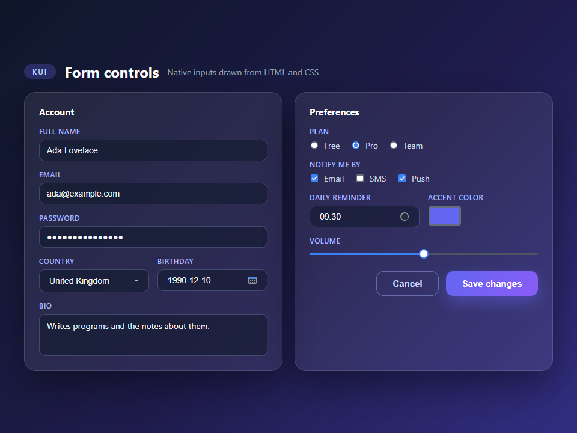<br><b>表单控件</b><br>文本、邮箱、密码、日期、时间、颜色输入框，下拉选择、单选、复选、滑块与多行文本，都是标准 HTML 表单控件，由 KUI 自己绘制。</td>
<td width="50%" valign="top">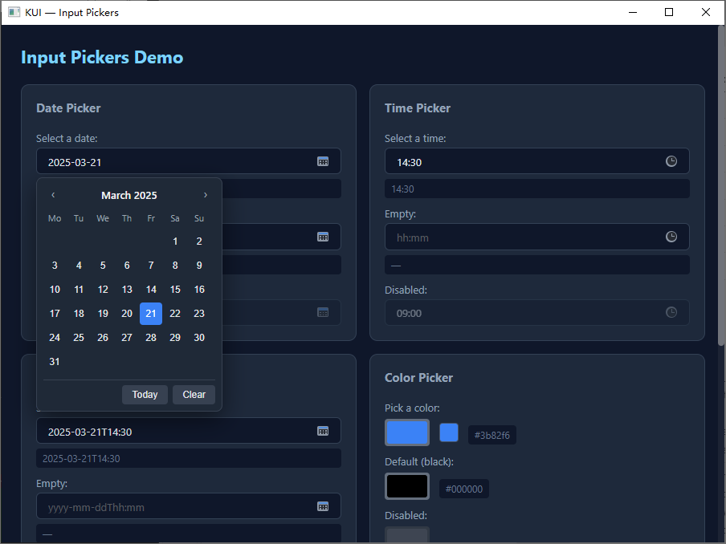<br><b>日期、时间与颜色选择</b><br>date、time、datetime-local 与 color 输入框自带选择器弹层（图为包里的 kui_cpp_html_22_input_pickers，已点开日期选择器；截图时把界面语言设成了英文）。</td>
</tr>
<tr>
<td width="50%" valign="top">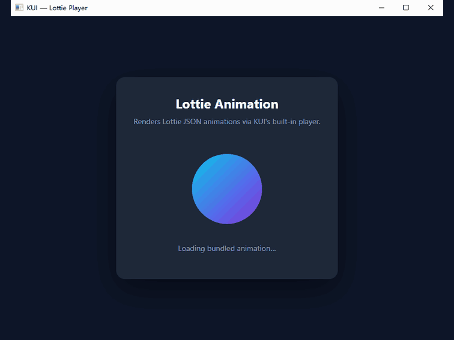<br><b>Lottie 动画</b><br>内置 Lottie 播放器，用 &lt;lottie-player&gt; 元素直接播放 JSON 动画。</td>
<td width="50%" valign="top">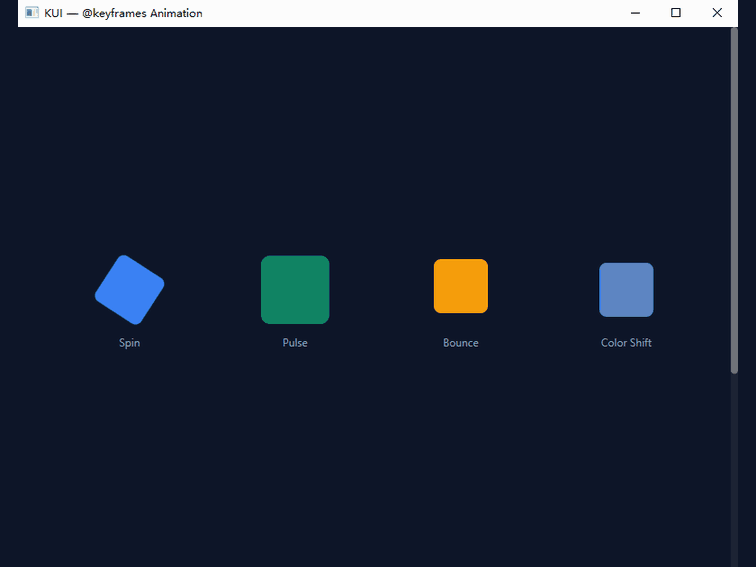<br><b>CSS 动画与过渡</b><br>@keyframes 动画与 transition，悬停、聚焦即触发。</td>
</tr>
<tr>
<td width="50%" valign="top">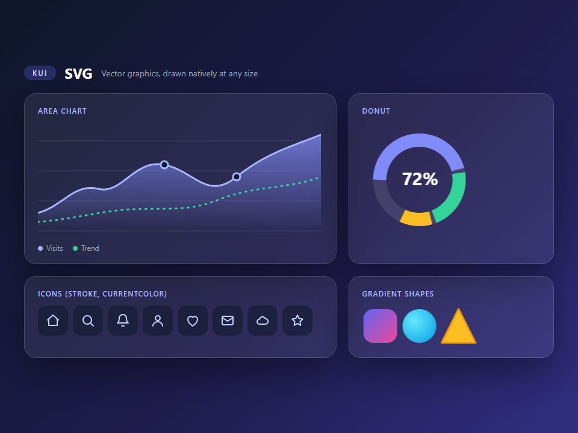<br><b>SVG</b><br>SVG 按矢量渲染：折线 / 面积图、环形图、描边图标与渐变图形，可用于 &lt;img&gt;、CSS 背景和内联元素。</td>
<td width="50%" valign="top">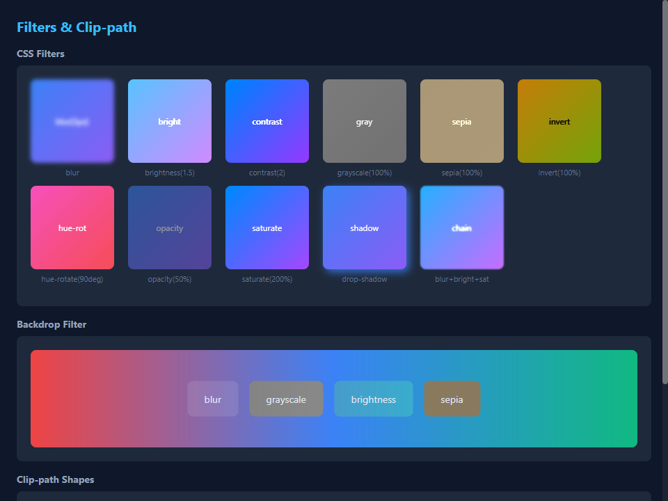<br><b>CSS 滤镜</b><br>blur、brightness、contrast、grayscale、sepia、hue-rotate、drop-shadow 等滤镜，以及 backdrop-filter。</td>
</tr>
<tr>
<td width="50%" valign="top">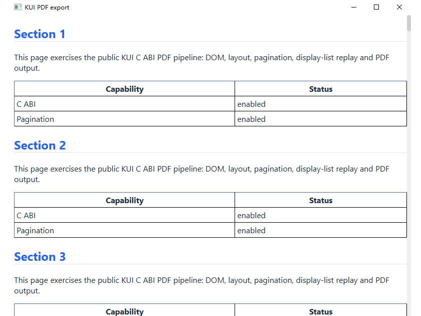<br><b>PDF 导出</b><br>页面经布局与分页后直接输出 PDF（图为被导出的页面）。</td>
<td width="50%" valign="top">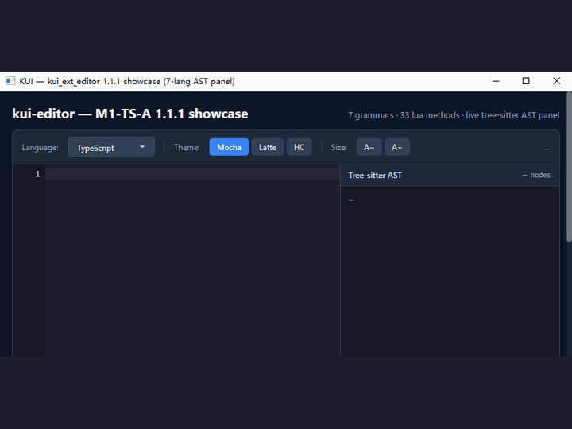<br><b>扩展：代码编辑器</b><br>kui_ext_editor 扩展：语法高亮、自动缩进、括号配对（图为 Windows 示例包里的 TypeScript 编辑）。</td>
</tr>
<tr>
<td width="50%" valign="top">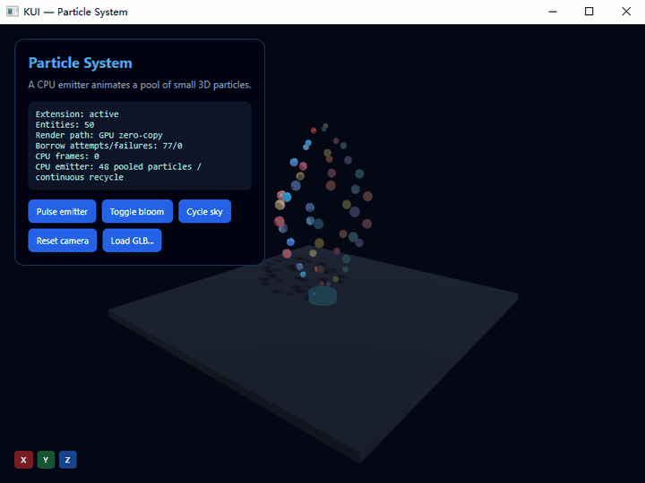<br><b>扩展：3D</b><br>kui_ext_3d 扩展：HTML 面板叠在实时 3D 场景上（图来自 C++ Wrapper 示例包的粒子示例）。</td>
<td width="50%" valign="top">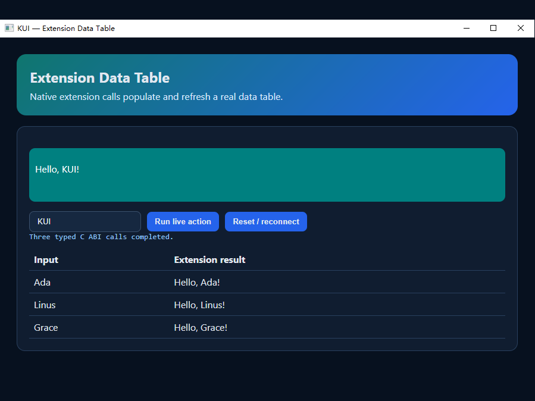<br><b>扩展：自定义控件</b><br>扩展可以注册自己的 HTML 元素，并通过类型化的 C 调用给页面返回数据（图为 C++ Wrapper 示例包的数据表示例）。</td>
</tr>
<tr>
<td width="50%" valign="top">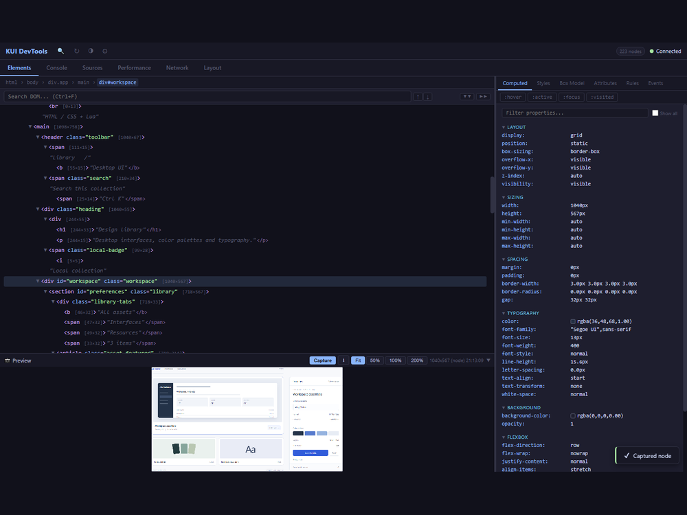<br><b>DevTools</b><br>内置 DevTools：DOM 树、计算样式、控制台、脚本、网络与布局面板。</td>
<td width="50%" valign="top">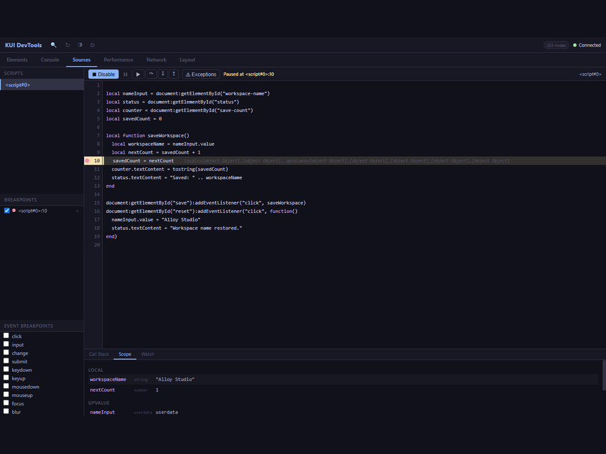<br><b>Lua 脚本与断点调试</b><br>页面脚本是可选的嵌入式 Lua；DevTools 支持断点、调用栈与作用域查看。</td>
</tr>
<tr>
<td width="50%" valign="top"><br><b>MCP：让 AI 调试界面</b><br>tools/devtools_mcp 把 DevTools 接给 MCP 客户端，AI 可以读取并修改运行中的 KUI 程序（图为一次修改前后）。</td>
<td width="50%" valign="top">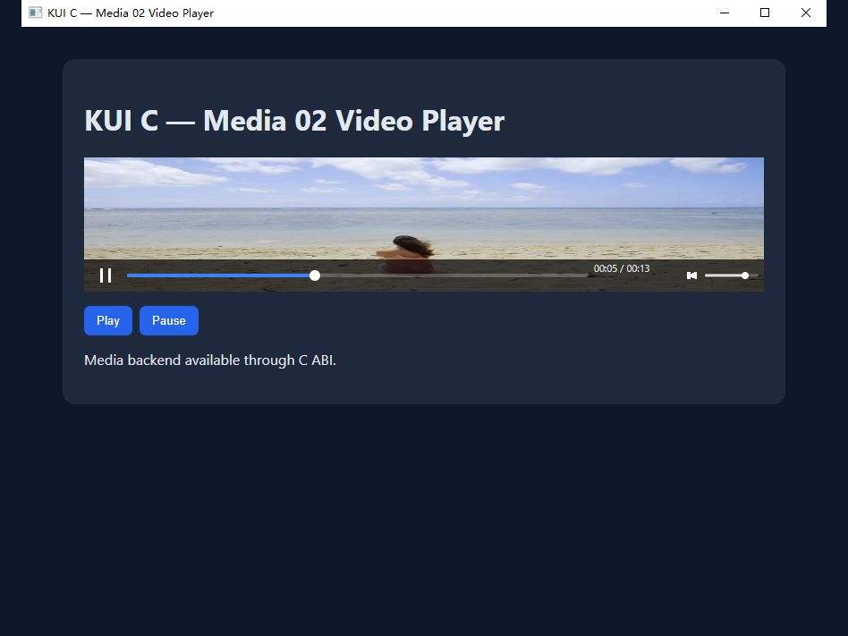<br><b>音视频</b><br>&lt;video&gt; 与 &lt;audio&gt; 由 kui_media_* 插件播放（图为视频播放器示例）。</td>
</tr>
</table>

### 用 KUI 做的应用

下面是用 KUI 做的应用（只有截图）。**它们的源码与预编译程序计划随下一个版本的 SDK 发布，本版没有包含。**

<table>
<tr>
<td width="33%" valign="top">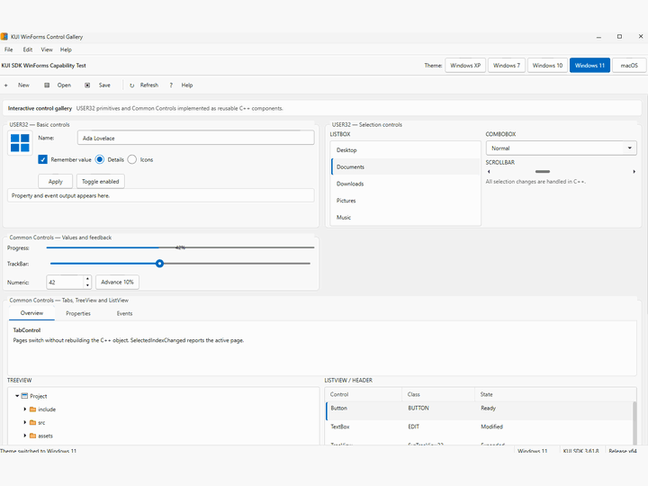<br><b>WinForms 控件库</b><br>用 KUI 写的 WinForms 风格控件库（Button、ListView、TreeView、TabControl 等），一键在 Windows XP / 7 / 10 / 11 与 macOS 五种风格间切换。</td>
<td width="33%" valign="top">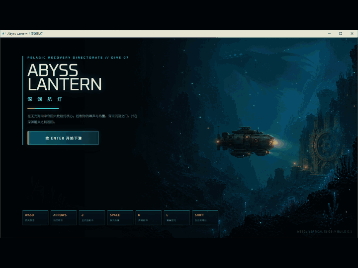<br><b>深渊航灯（Abyss Lantern）</b><br>KUI Games 里的 2D 游戏《深渊航灯》，游戏画面由 KUI 渲染。</td>
<td width="33%" valign="top">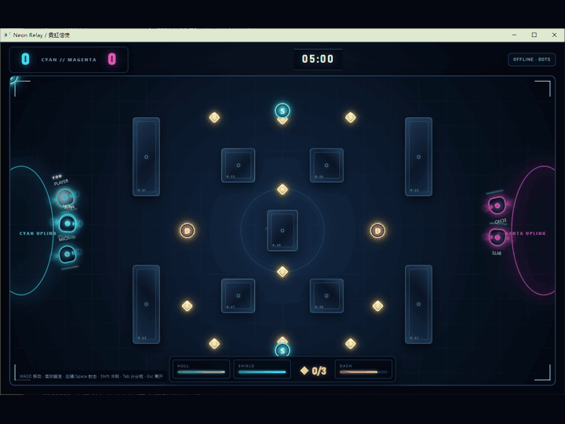<br><b>霓虹信使（Neon Relay）</b><br>KUI Games 里的 2D 团队夺取游戏（图为单机训练对局），与上一项《深渊航灯》在同一个仓库。</td>
</tr>
</table>

### 各平台的真实运行画面

同一批桌面应用界面（仪表盘与设置页，都是预编译示例包里的页面）在各平台上的真实运行画面。三个平台用同一条命令（包里的 `kui_c_advex_host`，页面 1024×768），图里只有页面、没有窗口边框；字体随各平台的系统字体，字形与行高因此略有不同。

<table>
<tr>
<td width="33%" valign="top"><b>Windows 10 x64</b><br>经 KUI 的 DevTools 取页面内容。</td>
<td width="33%" valign="top"><b>Linux x64（Debian 12）</b><br>虚拟机里 Xvfb 软件渲染，从屏幕上裁出窗口内容。</td>
<td width="33%" valign="top"><b>macOS 15 arm64</b><br>经 KUI 的 DevTools 取页面内容（取图用的会话没有屏幕录制权限）。</td>
</tr>
<tr>
<td width="33%" valign="top">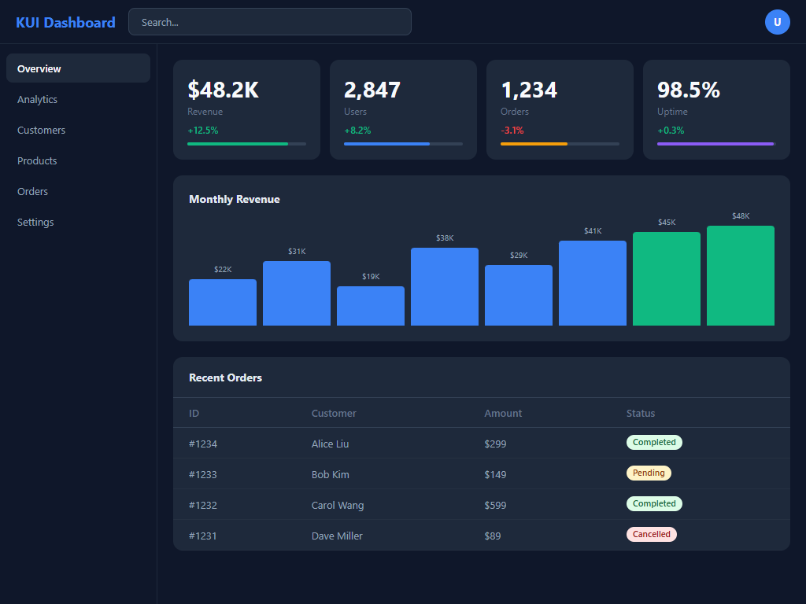</td>
<td width="33%" valign="top"></td>
<td width="33%" valign="top">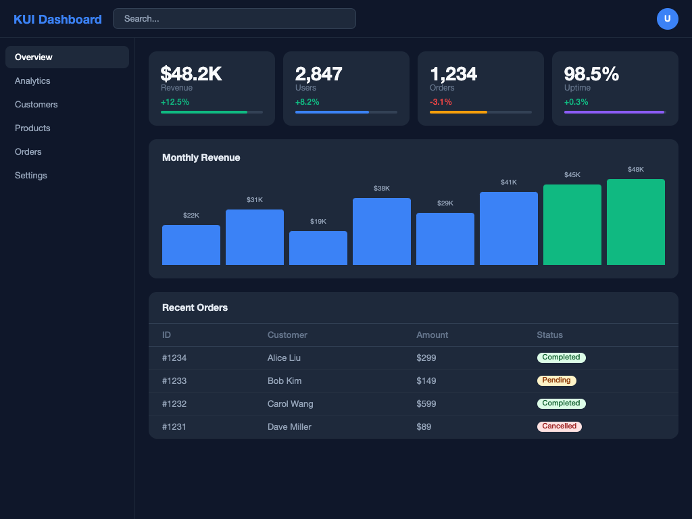</td>
</tr>
<tr>
<td width="33%" valign="top">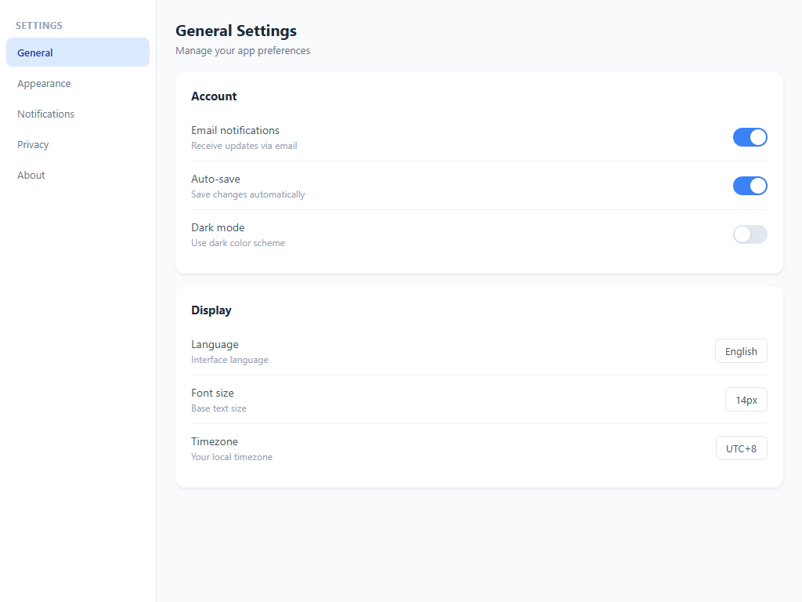</td>
<td width="33%" valign="top">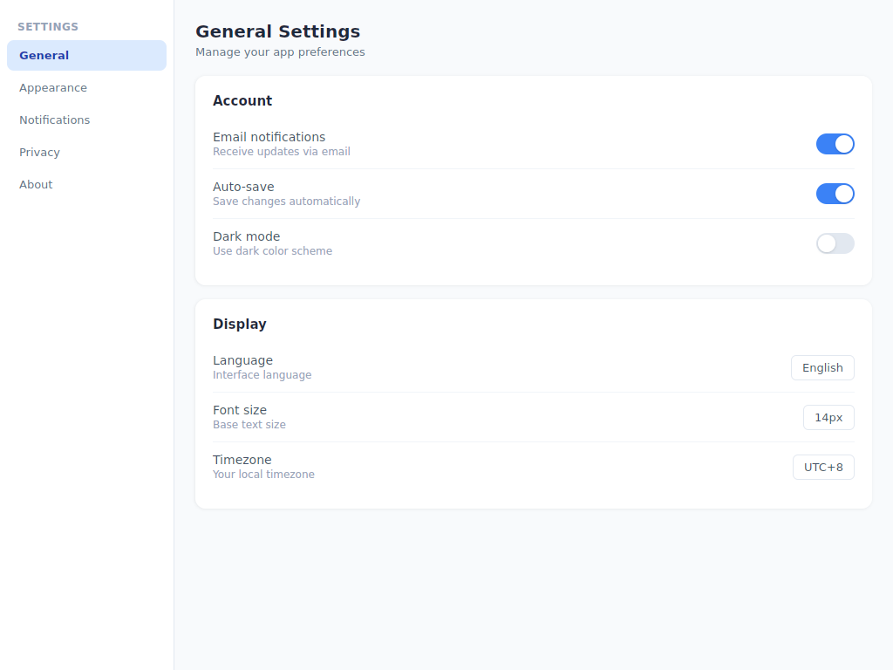</td>
<td width="33%" valign="top">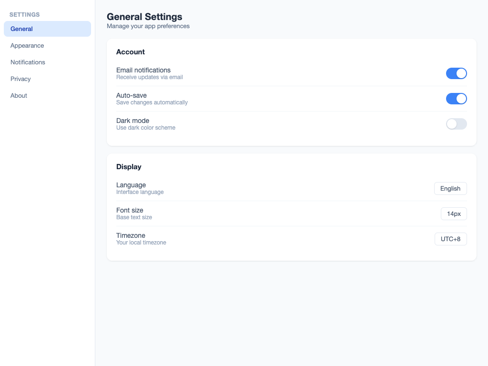</td>
</tr>
</table>

### 选哪个

| 你用 | 源码仓库（clone 即用） | Release 上的 SDK 包 | 说明 |
|---|---|---|---|
| C++ | [kui-cpp](https://github.com/kui-engine/kui-cpp)（推荐） | `kui-cpp-wrapper-sdk` | 头文件在你的工程里用你的编译器编译，唯一的二进制边界是纯 C ABI；MSVC、clang-cl、gcc、Apple clang 都行，Windows 上 `/MD`、`/MDd`、`/MT`、`/MTd` 随意 |
| C | 本仓库 | `kui-c-sdk` | `kui_c.h` 加运行库；C ABI 在 3.x 内只追加，升级换运行库即可 |
| Go | [kui-go](https://github.com/kui-engine/kui-go) | `kui-go-sdk` | `go get github.com/kui-engine/kui-go/v3@v3.1.0`（模块里不带运行库，运行库在仓库的 `runtime/` 或 SDK 包里） |
| Rust | [kui-rust](https://github.com/kui-engine/kui-rust) | `kui-rust-sdk` | git 依赖 `kui = { git = "https://github.com/kui-engine/kui-rust", tag = "v3.1.0" }`，`kui-sys` 自动用仓库里的 `runtime/<平台>`（`KUI_C_SDK` 可改指别处） |

### 获取

```bash
git clone --depth 1 https://github.com/kui-engine/kui.git
```

仓库自带三个平台的运行库（`runtime/`，本版共 475.7 MiB），克隆完就能编译、运行。**请用 `--depth 1`**：每个版本都把运行库提交进历史，完整历史会随版本增加而变大（每个版本约多一份 runtime/ 的大小）。要换版本时用 `git clone --depth 1 --branch v<版本> …`，或在已有克隆里 `git fetch --depth 1 origin tag v<版本>`。

### 编译并运行一个 C 示例

要求：CMake 与 C 编译器（Windows：Visual Studio 2022 的 MSVC；Linux：gcc / clang；macOS：Xcode 命令行工具）。CMake 的最低版本以 `CMakeLists.txt` 的声明为准（3.20），本版实际验证过的版本见下表。

**Linux 另需**：运行库依赖系统的 libX11、libXext、libXrandr、libGL 与 libstdc++（Debian / Ubuntu 上常见包名 `libx11-6 libxext6 libxrandr2 libgl1`；服务器版默认没有 X11 与 GL 运行库）。程序要连图形会话，没有桌面时在命令前加 `xvfb-run -a`（Go / Rust 的 `./build.sh` 会跑测试，同样需要显示服务器）。

在仓库根目录，Windows（PowerShell；导出自检从干净的 `git clone` 原样执行这组命令，程序启动并正常运行）：

```powershell
cmake -S c/examples -B build/c-examples "-DKuiC_DIR=$PWD/cmake"
cmake --build build/c-examples --config Release --target kui_c_example_hello_world
.\build\c-examples\Release\kui_c_example_hello_world.exe
```

Linux / macOS（bash；macOS 命令相同。导出后在真实 `git clone` 里验证过：Linux（Debian 12，Xvfb）原样执行这组命令，构建并启动通过；macOS arm64 构建与依赖闭合通过，**没有启动带窗口的程序**（构建机是共享设备））：

```bash
cmake -S c/examples -B build/c-examples "-DKuiC_DIR=$PWD/cmake" -DCMAKE_BUILD_TYPE=Release
cmake --build build/c-examples --target kui_c_example_hello_world
./build/c-examples/kui_c_example_hello_world
```

本版实际验证过的工具链：

| 平台 | 系统 | CMake 与 C / C++ 编译器 | Go | Rust |
|---|---|---|---|---|
| Windows x64 | Windows 10 | CMake 3.31.6、MSVC 19.43（Visual Studio 2022）；Go 的 cgo 用 LLVM clang 22.1.6 | 1.26.7 | 1.98.0 |
| Linux x64 | Debian 12（Xvfb） | CMake 4.4.0、gcc 12.2.0 | 1.26.7 | 1.98.0 |
| macOS arm64 | macOS 15.7.2 | CMake 4.0.2、Apple clang 17.0.0 | 1.26.7 | 1.98.0 |

去掉 `--target` 就编全部 11 个。225 个 canonical 示例在 `c/examples/canonical/`：页面与素材只有**整体编译**时才复制到程序旁边
（复制素材的目标依赖全部 225 个程序；只编单个目标再运行会报 `asset not found`），程序输出在 `build/c-canonical/Release/`
（Linux / macOS 也是这个目录）。Windows（导出自检实测）：

```powershell
cmake -S c/examples/canonical -B build/c-canonical "-DKuiC_DIR=$PWD/cmake"
cmake --build build/c-canonical --config Release --parallel 4
.\build\c-canonical\Release\kui_c_native_html_01_box_model.exe
```

Linux / macOS（Linux 上导出后在真实 clone 里实测，4 核约 15 秒）：

```bash
cmake -S c/examples/canonical -B build/c-canonical "-DKuiC_DIR=$PWD/cmake" -DCMAKE_BUILD_TYPE=Release
cmake --build build/c-canonical --parallel 4
./build/c-canonical/Release/kui_c_native_html_01_box_model
```

**运行库怎么找到**：Windows 由 `kui_c_copy_runtime_dlls` 把 DLL 复制到程序旁边。Linux / macOS 上 CMake 构建出的程序带指向本仓库
`runtime/<平台>/lib` 的**绝对** RPATH，所以在 clone 里直接能跑，但 clone 目录挪走或删掉后就找不到库。要分发给别人，把程序和
`runtime/<平台>/` 里的库放进同一目录，并给程序设相对 RPATH（Linux `$ORIGIN`，macOS `@executable_path`；预编译示例包就是这样布局的），
Windows 把 DLL 放在程序旁边即可。

在你自己的 CMake 工程里：`find_package(KuiC 3 CONFIG REQUIRED)`（`-DKuiC_DIR=<本仓库>/cmake`），
`target_link_libraries(my_app PRIVATE KuiC::C)`，`kui_c_copy_runtime_dlls(my_app)` 把运行库复制到程序旁边。`cmake/KuiCConfig.cmake` 按当前
平台从 `runtime/<平台>/` 取运行库，其余行为与 SDK 包里的那份相同（Debug 配置同样用 Release 运行库、MSVC 加 `/utf-8`）。

### runtime/ 里有什么

| 目录 | 文件 | 大小 |
|---|---:|---:|
| `runtime/windows-x64/` | 17 | 166.7 MiB |
| `runtime/linux-x64/` | 16 | 227.7 MiB |
| `runtime/macos-arm64/` | 16 | 81.2 MiB |

内容取自 C 包的 `bin/`（`kui_c`、`kui`、扩展与媒体插件、pdfium、FFmpeg 与许可文本）与 `lib/`（Windows 导入库 `kui_c.lib`；Linux / macOS 的 `libkui_c`、`libkui`）。它们与 Release 上同平台 SDK 包里的那份逐字节相同、相对位置不变（Linux / macOS 的 RPATH 依赖这个相对位置）。

### Release 上有什么

每个版本的 [kui Release](https://github.com/kui-engine/kui/releases/tag/v3.61.8) 上有三类东西：

1. **SDK 包** `kui-<语言>-sdk-<版本>-<平台>.zip`：就是对应源码仓库在一个平台上的打包（`runtime/<平台>/` 在包里是 `bin/`、`lib/`，Go / Rust 是 `native/`），不带预编译示例程序；不想 `git clone` 时下载它。
2. **预编译示例包** `kui-<语言>-examples-<版本>-<平台>.zip`：示例程序加运行库，解压后进 `bin/` 直接运行，不需要编译器。
3. **校验和** `SHA256SUMS.txt`（只列上面两类包）与 FFmpeg 对应源码。

| 包 | 内容 | Windows x64 | Linux x64 | macOS arm64 |
|---|---|---|---|---|
| `kui-c-sdk` | SDK（= 源码仓库的单平台打包） | [zip](https://github.com/kui-engine/kui/releases/download/v3.61.8/kui-c-sdk-3.61.8-windows-x64.zip) | [zip](https://github.com/kui-engine/kui/releases/download/v3.61.8/kui-c-sdk-3.61.8-linux-x64.zip) | [zip](https://github.com/kui-engine/kui/releases/download/v3.61.8/kui-c-sdk-3.61.8-macos-arm64.zip) |
| `kui-cpp-wrapper-sdk` | SDK（= 源码仓库的单平台打包） | [zip](https://github.com/kui-engine/kui/releases/download/v3.61.8/kui-cpp-wrapper-sdk-3.61.8-windows-x64.zip) | [zip](https://github.com/kui-engine/kui/releases/download/v3.61.8/kui-cpp-wrapper-sdk-3.61.8-linux-x64.zip) | [zip](https://github.com/kui-engine/kui/releases/download/v3.61.8/kui-cpp-wrapper-sdk-3.61.8-macos-arm64.zip) |
| `kui-go-sdk` | SDK（= 源码仓库的单平台打包） | [zip](https://github.com/kui-engine/kui/releases/download/v3.61.8/kui-go-sdk-3.1.0-windows-x64.zip) | [zip](https://github.com/kui-engine/kui/releases/download/v3.61.8/kui-go-sdk-3.1.0-linux-x64.zip) | [zip](https://github.com/kui-engine/kui/releases/download/v3.61.8/kui-go-sdk-3.1.0-macos-arm64.zip) |
| `kui-rust-sdk` | SDK（= 源码仓库的单平台打包） | [zip](https://github.com/kui-engine/kui/releases/download/v3.61.8/kui-rust-sdk-3.1.0-windows-x64.zip) | [zip](https://github.com/kui-engine/kui/releases/download/v3.61.8/kui-rust-sdk-3.1.0-linux-x64.zip) | [zip](https://github.com/kui-engine/kui/releases/download/v3.61.8/kui-rust-sdk-3.1.0-macos-arm64.zip) |
| `kui-c-examples` | 预编译示例（解压即运行） | [zip](https://github.com/kui-engine/kui/releases/download/v3.61.8/kui-c-examples-3.61.8-windows-x64.zip) | [zip](https://github.com/kui-engine/kui/releases/download/v3.61.8/kui-c-examples-3.61.8-linux-x64.zip) | [zip](https://github.com/kui-engine/kui/releases/download/v3.61.8/kui-c-examples-3.61.8-macos-arm64.zip) |
| `kui-cpp-wrapper-examples` | 预编译示例（解压即运行） | [zip](https://github.com/kui-engine/kui/releases/download/v3.61.8/kui-cpp-wrapper-examples-3.61.8-windows-x64.zip) | [zip](https://github.com/kui-engine/kui/releases/download/v3.61.8/kui-cpp-wrapper-examples-3.61.8-linux-x64.zip) | [zip](https://github.com/kui-engine/kui/releases/download/v3.61.8/kui-cpp-wrapper-examples-3.61.8-macos-arm64.zip) |
| `kui-go-examples` | 预编译示例（解压即运行） | [zip](https://github.com/kui-engine/kui/releases/download/v3.61.8/kui-go-examples-3.1.0-windows-x64.zip) | [zip](https://github.com/kui-engine/kui/releases/download/v3.61.8/kui-go-examples-3.1.0-linux-x64.zip) | [zip](https://github.com/kui-engine/kui/releases/download/v3.61.8/kui-go-examples-3.1.0-macos-arm64.zip) |
| `kui-rust-examples` | 预编译示例（解压即运行） | [zip](https://github.com/kui-engine/kui/releases/download/v3.61.8/kui-rust-examples-3.1.0-windows-x64.zip) | [zip](https://github.com/kui-engine/kui/releases/download/v3.61.8/kui-rust-examples-3.1.0-linux-x64.zip) | [zip](https://github.com/kui-engine/kui/releases/download/v3.61.8/kui-rust-examples-3.1.0-macos-arm64.zip) |

### 平台

| 平台 | 状态 | 打包时实际做过的验收 |
|---|---|---|
| Windows x64 | Full Profile GA | 4 个 SDK 包解压后从包内源码重建，并通过包外使用方矩阵；4 个预编译示例包的全部程序逐个实际启动（C 222、C++ Wrapper 190、Go 219、Rust 219）。导出后另在四个仓库的真实 `git clone` 里按 README 命令构建并启动（含零参数 `build.ps1`） |
| Linux x64 | 同一冻结 C ABI 的 Release 包 | SDK 包从包内源码重建全部通过；示例包在 Xvfb 下启动：C 221/222、C++ Wrapper 190/190、Go 218/219、Rust 218/219；C、Go、Rust 各有 1 个托盘示例未启动（Xvfb 没有托盘宿主，`kui_window_tray_create` 返回不支持），按白名单放行。导出后另在四个仓库的真实 `git clone` 里按 README 命令构建并在 Xvfb 下启动（含 Go / Rust 零参数 `build.sh` 各 219 个程序） |
| macOS arm64 | 同一冻结 C ABI 的 Release 包 | SDK 包在包内源码重建全部通过（C 11 + 211、C++ Wrapper 189 + demo + 3 组测试、Go / Rust 8 + 211），重建后不启动；示例包只核对布局、清单、运行库逐字节一致、依赖与 RPATH，另启动 6 个无窗口 C 示例与 C++ Wrapper demo。**带窗口程序的全量启动没有在 macOS 上做**（构建机是共享设备）。导出后另在四个仓库的真实 `git clone` 里零参数构建（含 Go / Rust `build.sh` 各 219 个程序）并核对依赖与 rpath 闭合，只运行无窗口的程序与测试，**没有启动带窗口的程序** |

三个平台都只带 Release 运行库、不带调试符号；你的 Debug 构建同样链接它（C ABI 不跨边界传 CRT 对象）。平台能力并非完全对称，已知差异见 `docs/known_issues.md`。

### 下载后无法运行

预编译程序与运行库暂未签名：

- **Windows**：从浏览器下载的 zip 解压后，SmartScreen 提示「Windows 已保护你的电脑」时点「更多信息」→「仍要运行」；也可以在 PowerShell 里对解压目录执行 `Get-ChildItem -Recurse <解压目录> | Unblock-File` 一次性解除。`git clone` 得到的文件不带「来自网络」标记，不会被 SmartScreen 拦。
- **macOS**：从浏览器下载的 zip 解压后会被 Gatekeeper 拦下，执行 `xattr -dr com.apple.quarantine <解压目录>`。
- **Linux**：用不保留权限的工具解压时，对 `bin/` 下的程序执行 `chmod +x`（`git clone` 会保留运行库的可执行位）。

### 许可证与第三方组件

MIT，见 `LICENSE`（版权方 Alloy）。

KUI 本体是 MIT。视频插件 `kui_media_video` 以独立动态库方式加载 FFmpeg（LGPL-3.0-or-later，LGPL 构建，没有 `--enable-gpl` / `--enable-nonfree`）；不需要视频时不部署 `kui_media_video` 与 FFmpeg 库即可，音频插件不用 FFmpeg。仓库的 `runtime/<平台>/` 与每个包里，FFmpeg 库旁都有 `LICENSE.FFmpeg.txt`（LGPLv3）与 `LICENSE.FFmpeg.GPLv3.txt`，其余第三方组件均为宽松许可证，详见 `THIRD_PARTY_NOTICES.md`。

**随二进制分发的 FFmpeg 库的对应源码**作为 [kui 的 Release](https://github.com/kui-engine/kui/releases/tag/v3.61.8) 附件提供，校验值见 `FFMPEG_SOURCE_SHA256SUMS.txt`：

- Windows x64 / Linux x64（BtbN 构建 `autobuild-2026-10-31-12-59`，FFmpeg `n9.0.2-39-g7adfbe40dc`）：`ffmpeg-7adfbe40dcde598f93a6963d2f7b22cd75202ccc.tar.gz`（FFmpeg 提交 `7adfbe40dcde598f93a6963d2f7b22cd75202ccc` 的源码）与 `FFmpeg-Builds-autobuild-2026-10-31-12-59.tar.gz`（该构建的脚本）；
- macOS arm64（官方发布包源码构建）：`ffmpeg-9.0.2.tar.xz` 与签名 `ffmpeg-9.0.2.tar.xz.asc`。

上游地址：<https://github.com/FFmpeg/FFmpeg/tree/7adfbe40dcde598f93a6963d2f7b22cd75202ccc>、<https://github.com/BtbN/FFmpeg-Builds/tree/autobuild-2026-10-31-12-59>、<https://ffmpeg.org/releases/ffmpeg-9.0.2.tar.xz>。

### 仓库内容

| 路径 | 内容 |
|---|---|
| `c/include/` | `kui_c.h`（冻结的 C ABI）与扩展、媒体插件两个纯 C 协议头 |
| `c/abi/` | 冻结导出清单与签名摘要 |
| `c/examples/` | 11 个纯 C 示例与 225 个 canonical 示例（含页面与素材） |
| `c/extensions/` | 最小扩展 `hello/` 与音频插件 `kui_media_audio/` 的源码 |
| `c/src/`、`c/tests/`、`c/CMakeLists.txt` | C ABI 层实现与 C 测试，**仅供参考**：构建它们需要不公开的原生 C++ SDK，用户用 `runtime/` 里的预编译运行库即可 |
| `cmake/` | `find_package(KuiC)` 的仓库版配置 |
| `runtime/` | 三个平台的运行库（见上） |
| `docs/` | 与语言无关的文档：功能、CSS 支持矩阵、已知问题、性能、DevTools、Lua 等 |
| `tools/devtools_mcp/` | 调试运行中的 KUI 程序的 DevTools MCP 服务器 |
